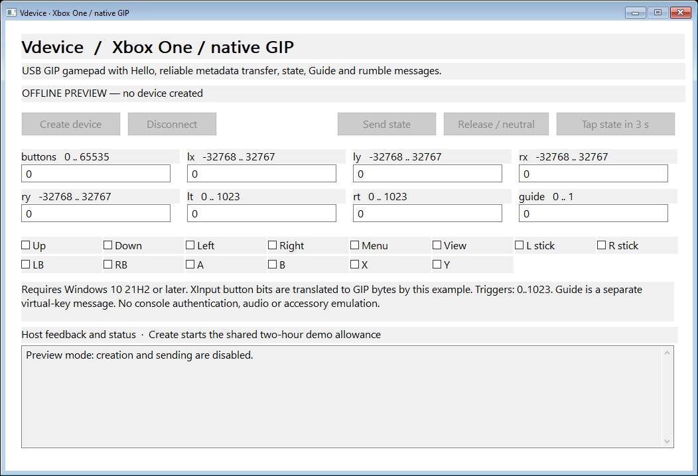

# Graphical examples

The five standalone native control panels use the same C++ protocol definitions
as the console examples: keyboard, mouse, Xbox 360, DualShock 4 and Xbox One GIP.
Run `VdeviceKeyboardUI.exe`, `VdeviceMouseUI.exe`, `VdeviceXbox360UI.exe`,
`VdeviceDualShock4UI.exe` or `VdeviceXboxOneGipUI.exe` from the Examples release.

Click **Create device** and accept UAC if needed. Wait for **READY**, edit fields
or toggle button bits, then click **Send state**. **Release / neutral** releases
held inputs; **Disconnect** removes the device. **Tap state in 3 s** lets you
focus another application, sends the selected state, then releases after 50 ms.
Fields use decimal numbers or a `0x` prefix; mouse motion is relative.

`--preview` opens an offline window with creation and sending disabled. The
README images were rendered from this mode. The panels are standard Win32
applications, with no additional runtime DLL to distribute.

## Descriptor Workshop

Build with the repository's `Build.ps1`, then run `bin/ExamplesUI/VdeviceExampleUI.exe` with the driver installed. Keep `VdeviceBridge.dll` beside the executable. The window starts with an empty document.

1. Import `CustomDevice.json`, or add your own descriptor and control-rule rows.
2. Select **Validate offline**. It checks the exact bytes without opening the driver.
3. Select **Create device**, then select its entry in **Owned devices**.
4. Send raw bytes on an IN endpoint. Inspect full Windows OUT/control packets, or reply/stall a pending control request.
5. Delete the device when finished. Closing the application disposes all devices it owns.

`CustomDevice.json` is a fully editable example outside the SDK: vendor-defined HID usage page `FF00`, 16-byte input/output/feature reports, interrupt IN `81` and OUT `01`, no report ID. For a neutral example transfer, send sixteen `00` bytes on `81`. It creates no keyboard or mouse input. VID `FFFF` is a development identity; use assigned IDs for distributed hardware identities.

Every descriptor selector is explicit: kind, index, language and interface. The two string rows show English `0409` and French `040C` selections. The sample's `5A` vendor request has a fixed four-byte reply; `5B` is accepted and `5C` stalled. Unmatched delegated requests appear in **Reply** and have a five-second driver deadline. Use control rules for responses that must be immediate.

Descriptor lengths, configuration `wTotalLength`, HID report length, endpoint framing and little endian fields must agree. The editor never rewrites them. Changes apply to the next creation. Raw protocols have no universal release/reset state; send the appropriate bytes for your protocol explicitly. The field-guide tab explains these fields, and JSON export preserves the complete document.

The bridge uses only `Validate_Device`, `Create_Device`, `Delete_Device`, `Send_Input`, `Get_Output`, `Respond_Output` and `Get_Info`. It contains no device-family profiles or report encoders.
