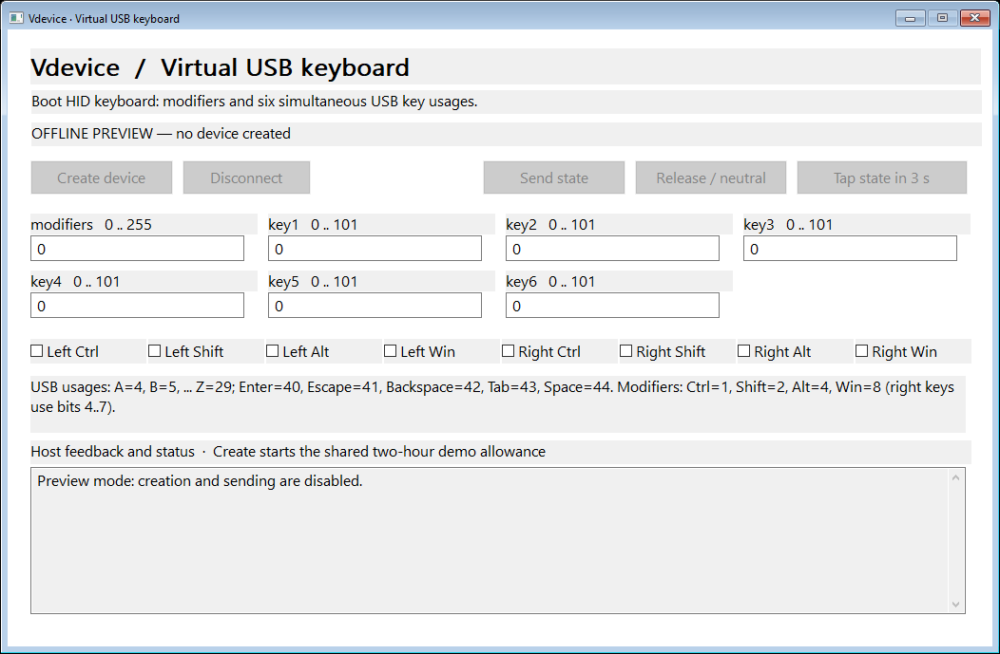
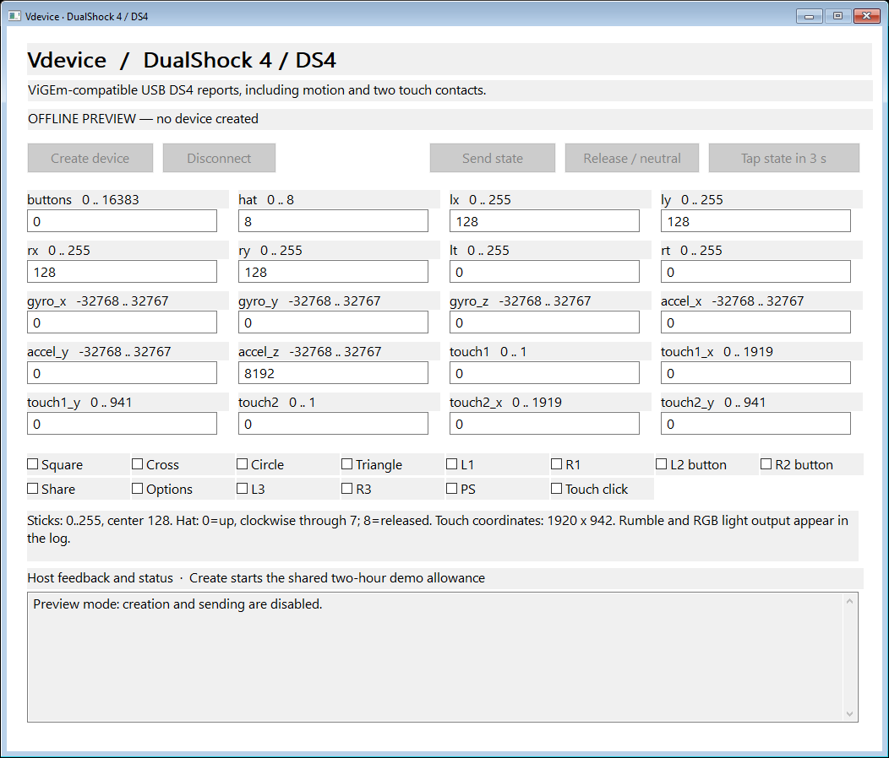

# Vdevice

<!-- simple-start:start -->
Make Windows see a virtual keyboard, mouse or gamepad.

[First steps](#first-steps) · [Develop](#sdk-and-packages) · [Maintain](https://github.com/TitanCSA/sdk-packages/blob/main/CONTRIBUTING.md)

## First steps

**Windows 10 or 11, 64-bit.**

1. Run [VdeviceSetup.exe](https://github.com/TitanCSA/Vdevice/releases/download/v1.0.6.1-demo/VdeviceSetup.exe) and choose **Install**. If setup asks for a restart, restart Windows and reopen it.
2. Extract the [examples ZIP](https://github.com/TitanCSA/Vdevice/releases/download/v1.0.6.1-demo/Vdevice-Examples-1.0.6.1.zip) and open **VdeviceMouseUI.exe**.
3. Click **Create device** and wait for **READY**. Set **x** to **32** and **y** to **0**, then click **Send state**. The pointer should move. Click **Disconnect** when you finish.
<!-- simple-start:end -->

[Premier essai en français](https://titancsa.github.io/fr/souris-usb-virtuelle-vdevice/)

<!-- full-version-contact:start -->
> [!IMPORTANT]
> **Version without the one-hour demo limit**
>
> In [Discord](https://discord.com/app), choose **Add Friend** and enter **`titancsa`**. Send the project name. Purchase details are sent privately.
<!-- full-version-contact:end -->

<details>
<summary>Project details and screenshots</summary>

<!-- known-stability:start -->
> **WDF-001 update:** the Microsoft-signed **1.0.6.1 demo** includes the controller teardown fix. The Demo installers passed in-place upgrade and removal tests on Windows 10 and Windows 11 with Secure Boot enabled. Signed Release **1.0.4.1** includes the fix too. [Installation evidence](https://titancsa.github.io/assets/vdevice-signed-versions-2026-11-25.json). [Incident notes](https://github.com/TitanCSA/Vdevice/issues/1).
<!-- known-stability:end -->

Create and control **virtual USB devices** on **Windows 10/11 x64** with a
**Microsoft-signed kernel driver** and a **two-file C++17 SDK**. Define raw USB/HID
descriptors, VID/PID, strings, endpoints and reports. Every device uses the same
seven library operations; model-specific protocols live in the examples.

**[Download](https://github.com/TitanCSA/Vdevice/releases/latest)** |
[Installation](docs/INSTALLATION.md) | [Raw C++ API](docs/API.md) |
[Graphical examples](Examples/UI/README.md) | [Compatibility](docs/VALIDATION.md)


| Keyboard control panel | DS4 control panel |
| --- | --- |
|  |  |

Screenshots show offline previews of the applications, not hardware tests.

</details>

## Install and try

For a commercial ZIP, use the [Release activation troubleshooting guide](https://titancsa.github.io/guides/release-activation-help/) to check Windows error 2, the installed driver and SDK versions.


Run the [custom HID interoperability test](https://titancsa.github.io/guides/vdevice-custom-hid-test/) with hidapitester, or [check the ZIP and signed driver catalog](https://titancsa.github.io/guides/verify-windows-driver-package/) before setup. · [Vérifier le pilote avant installation (FR)](https://titancsa.github.io/fr/verifier-pilote-windows/)

Use a virtual keyboard to repeat an application's input test or experiment with
USB/HID descriptors without building a physical device. This runs on the Windows
PC; it is not Arduino firmware. A board with native USB HID may be simpler for a
standalone keyboard. [Use cases, board integration boundaries and a no-text diagnostic checklist](docs/USE-CASES.md).

1. Download **VdeviceSetup.exe** from the latest release and accept elevation.
2. Choose **Install** or **Reinstall / repair**. Wait for **Installed and ready**;
   if Windows requests a restart, save your work and use **Restart Windows**.
3. Extract the release's **Vdevice-Examples** ZIP and open a control panel.
4. Accept the administrator prompt on opening the example, then click **Create device** and wait for **READY**.
5. Change fields and press **Send state**. **Release / neutral** releases held
   inputs; **Disconnect** removes the virtual device.

For a keyboard test, set `key1 = 4` (A), choose **Tap state in 3 s**, then focus
your editor. The example releases the key after 50 ms. Key usages follow the
target application's keyboard layout.

The console installer provides the same installation backend:

```powershell
.\VdeviceSetupConsole.exe /install
.\VdeviceSetupConsole.exe /status
.\VdeviceSetupConsole.exe /diagnose
.\VdeviceSetupConsole.exe /uninstall
```

The GUI reads installation, service and API state on opening and after each
operation. A **Restart Windows** button appears when a restart is required and
asks for confirmation. Exit code `3010` requests a restart; `1618` means another
Vdevice setup is already running. The GUI also supports removal. The driver
package is Microsoft-signed; installer and example EXEs have their own signature
status. [Installation and diagnostics](docs/INSTALLATION.md).

## Included devices and controls

| UI executable | Example |
| --- | --- |
| `VdeviceKeyboardUI.exe` | USB boot keyboard, modifiers, six keys and host LED feedback |
| `VdeviceMouseUI.exe` | Five buttons, signed 16-bit relative X/Y and vertical/horizontal wheels |
| `VdeviceXbox360UI.exe` | ViGEm-style XInput gamepad, sticks, triggers, buttons and rumble |
| `VdeviceDualShock4UI.exe` | DS4 USB interface, sticks, triggers, D-pad, motion, touch and rumble/RGB feedback |
| `VdeviceXboxOneGipUI.exe` | Native PC GIP gamepad, metadata, Guide, analog controls and motor commands |

**Descriptor Workshop** imports editable JSON descriptions and exchanges raw
reports. All device examples have a graphical interface; the console installer
remains available for command-line installation and diagnostics.
[Control panel instructions](Examples/UI/README.md).

## Applications built on Vdevice

| Project | Starting point |
| --- | --- |
| [Virtual Mouse Input](https://github.com/TitanCSA/Virtual-mouse-input) | A small MIT C++ example for virtual USB mouse descriptors, relative reports, buttons and wheels. Relative counts are not guaranteed screen pixels. |
| [HID Fixture Studio](https://github.com/titanfyre/HID-Fixture-Studio) | Build full-speed virtual HID fixtures from report descriptors. |
| [Input CI Runner](https://github.com/titanfyre/Input-CI-Runner) | Validate fixture JSON offline or run explicitly scheduled reports for application testing. |
| [Remote Device Control](https://github.com/TitanCSA/Remote-Device-Control) | A GPL-3.0 Windows host/viewer application using Vdevice keyboard/mouse input and Sunshine/Moonlight H.264 transport. Requires an unlocked console desktop and direct connectivity; no central relay, audio, clipboard or gamepad forwarding. |

Read each application's supported scope and license. Live device creation uses
the matching Vdevice demo driver and shares its one-hour-per-kernel-boot demo;
application source availability does not grant driver redistribution rights.

## How it works

The driver uses **KMDF / USB Device Emulation (UdeCx)** to enumerate virtual USB
devices from your descriptions. Windows selects a matching device driver from
those descriptors and identifiers. Your application sends device-to-host input
and handles host output or delegated control requests according to the protocol.
The SDK device object owns its device; deletion or process termination disconnects it.

Supported descriptions include low/full/high speed, one configuration, multiple
interfaces at alternate setting zero, and interrupt/bulk endpoints. SuperSpeed,
isochronous audio, external hubs and additional configurations/alternate settings
are outside the implemented scope. Changing a VID/PID alone does not reproduce
a device's firmware or authentication. [Protocol limits](docs/VALIDATION.md).

The GIP sample requires Windows 10 21H2 or later and uses Microsoft's documented
PC USB security opt-out interface. It does not emulate console authentication.
The Xbox 360 sample supplies the gamepad function; DS4 uses synthetic identity
and example calibration data. These are PC protocol examples, not complete
console firmware replicas.

<a id="raw-c-api"></a>

## Raw C++ SDK

**First SDK check.** Extract the [starter ZIP](https://titancsa.github.io/downloads/first-sdk-checks.zip) and run `python scripts/test_first_sdk.py vdevice --run` from that folder. It reads driver information without creating a virtual device. [Tools required](https://titancsa.github.io/guides/installer-and-sdk/).

Add [`Vdevice.h`](Vdevice/Vdevice.h) and [`Vdevice.cpp`](Vdevice/Vdevice.cpp) to your
Windows x64 C++17 application. The library contains no built-in device profiles.

| Operation | Purpose |
| --- | --- |
| `Validate_Device(config)` | Check descriptors and topology offline |
| `Create_Device(config)` | Create an owned virtual device |
| `Get_Output(timeout)` | Receive host output, control and device-state events |
| `Respond_Output(output, bytes, stall)` | Complete a delegated control request |
| `Send_Input(device, endpoint, bytes)` | Queue raw device-to-host input |
| `Get_Info()` | Read capabilities, demo state and owned devices |
| `Delete_Device(device)` | Disconnect and release a device |

Check each operation's `error` and `message`. Creation is asynchronous: service
outputs/controls during enumeration and wait for configuration before normal
input. Keep the move-only device object alive while using it. The
[mounting guide](docs/API.md) explains every descriptor field and lifecycle step;
the examples contain complete descriptor construction and report encoders.

<a id="downloads-and-source"></a>

## Downloads and build

Demo/evaluation driver source is available; see [driver/README.md](driver/README.md) for
build instructions and separate evaluation-source terms. Those terms apply to
Titan-authored driver code. Third-party source licenses and existing application/SDK
licenses remain applicable. Full/commercial implementation and private signing or
activation material are excluded.

The [latest release](https://github.com/TitanCSA/Vdevice/releases/latest) provides
both standalone installers, examples, SDK sources, the Microsoft-signed driver
package and **SHA256SUMS.txt**.

```text
Vdevice/           Vdevice.h and Vdevice.cpp
Examples/
  UI/              Control panels, raw protocols and Descriptor Workshop
Installer/
  Console/         Console installer and setup backend
  UI/              GUI installer and signed driver package
docs/ Tests/       API, installation and verification
```

Build with Visual Studio 2022 Desktop C++, a Windows SDK, CMake and .NET Framework
reference assemblies: `powershell -ExecutionPolicy Bypass -File .\Build.ps1`.
This builds user-mode components and runs offline tests. **Demo/evaluation driver source is documented in [driver/README.md](driver/README.md).** User-mode source is [MIT](LICENSE); prebuilt driver binaries have
[separate terms](licenses/BINARY-LICENSE.txt).

## Demo edition and related projects

**One hour per Windows kernel boot**, starting at the first successful virtual
device creation and shared across applications. Sleep counts; closing or
reinstalling does not reset it. Expiry disconnects virtual devices and refuses
new creation/transfers until Windows **Restart**. [Contact titancsa on Discord](https://titancsa.github.io/about/evidence/#release-contact).

The Xbox 360 and DS4 examples use descriptor/protocol material from
[nefarius/ViGEmBus](https://github.com/nefarius/ViGEmBus) under BSD-3-Clause;
ViGEmBus does not need to be installed. [Third-party notices](licenses/NOTICE).

To intercept and modify **physical** devices, use
[Interceptor](https://github.com/TitanCSA/Interceptor). Vdevice creates virtual
devices and uses its own driver.

## Responsible use and disclaimer

This project, including its drivers, SDKs, libraries, applications, installers and examples, was created for lawful, constructive purposes such as accessibility, device customization, research, testing and software development. Illegal, malicious or unauthorized use is neither intended nor endorsed by TitanCSA or the contributors.

You are solely responsible for how you use, modify or distribute the software, for obtaining any necessary authorization, and for complying with applicable laws, third-party rights and service rules. TitanCSA and the contributors do not accept responsibility for users' actions, including illegal activity or misuse of the drivers or SDKs.

To the maximum extent permitted by applicable law, the software is provided "AS IS", without warranties of any kind, and TitanCSA and the contributors are not liable for claims, damages, data loss, system damage or other consequences arising from its use or misuse. Nothing in this notice excludes liability that cannot legally be excluded. Existing project and third-party license terms remain applicable.

<!-- central-sdk-packages:start -->
<a name="paquets-et-installation"></a>

## SDK and packages

Choose a language in the [SDK and package guide](https://github.com/TitanCSA/sdk-packages/tree/main/projects/Vdevice#readme) for exact install commands and examples. If your example requires a driver or app, install it separately.
<!-- central-sdk-packages:end -->


## Performance & Benchmarks

[Measured results and raw data](https://titancsa.github.io/TitanCSA-Benchmarks/vdevice/latency/) · [Comparisons](https://titancsa.github.io/TitanCSA-Benchmarks/comparisons/) · [Methodology](https://titancsa.github.io/TitanCSA-Benchmarks/methodology/measurement/)

Vendor HID reports, independent keyboard/mouse and controller reception, and a matched WinMM joystick subset. These are publisher-operated Windows 11 Hyper-V software-path measurements, not physical USB latency or a universal speed ranking.

| Tested scope | Verified result |
|---|---|
| Vendor-defined HID delivery | 34 validated runs; 61,000 post-warmup reports |

**Vdevice benchmark status.** The original campaign recorded a controller teardown crash with demo 1.0.5.0. The signed 1.0.6.0 demo passed separate teardown tests. The fix is available in signed Demo 1.0.6.1 and signed Release 1.0.4.1. The [dated installer record](https://titancsa.github.io/assets/vdevice-signed-versions-2026-11-25.json) covers Windows 10 and 11 upgrades and pre-activation readiness. [Incident and edition status](https://titancsa.github.io/TitanCSA-Benchmarks/methodology/incident-wdf-001/).
